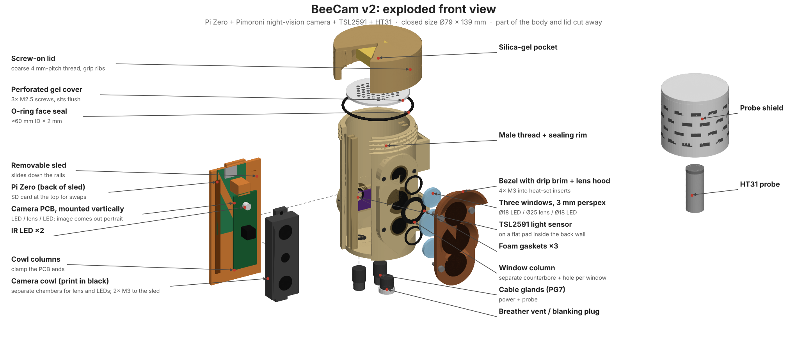

# InsectSnapshot 🦋

**An environmental monitoring project with a purpose-built insect monitoring housing unit.**

\<!-- Project image: replace with the actual image filename in assets/ -->

\<p align="center">   \ \</p>

## About the Project

InsectSnapshot is a project focused on developing a physical housing unit and associated code for environmental monitoring.

The repository contains the design files and supporting resources needed to build and develop the monitoring unit.

## Repository Structure

```text
InsectSnapshot/
│
├── 3D print/       # 3D-printable housing components
│
├── assets/         # Project images and supporting assets
│
├── laser_files/    # Laser-cutting design files
│
└── README.md       # Project documentation
```

## Hardware & Design

The project includes several manufacturing resources:

- **3D printing:** Files for producing the physical housing components.
- **Laser cutting:** Design files for laser-cut parts.
- **Housing unit:** Physical enclosure designed for the environmental monitoring project.

## Getting Started

1. Clone this repository:

   ```bash
   git clone https://github.com/shepai/InsectSnapshot.git
   ```

2. Navigate into the project:

   ```bash
   cd InsectSnapshot
   ```

3. Explore the repository folders:

   - Open `3D print/` to access the 3D-printing files.
   - Open `laser_files/` to access the laser-cutting files.
   - Open `assets/` to view project images and resources.

4. Prepare the relevant manufacturing files using compatible 3D-printing or laser-cutting software.

## Project Goals

- Develop a practical housing unit for environmental monitoring.
- Provide accessible manufacturing files for reproducing the hardware.
- Develop and maintain the associated monitoring code.
- Document the hardware and software to support future development.

## Contributing

Contributions, suggestions and improvements are welcome. Feel free to open an issue or submit a pull request.

## License

Please check the repository for licensing information before reusing or distributing project files.

---

**InsectSnapshot**
Environmental Monitoring · Hardware Design · Open Development

